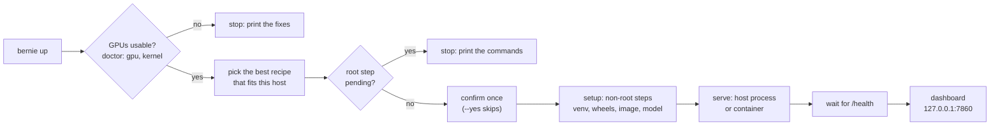

# bernie

Run vLLM on AMD ROCm GPUs without the guesswork.

bernie is one static binary. It checks your machine, tells you what is
missing, installs the stack, starts vLLM from a recipe, applies tuning,
benchmarks the server and shows it all in a web dashboard. Every feature is a
CLI command with `--json` output, so scripts and AI agents can drive it.

What happens on `bernie up`:



## Quick start

It is one file. Put it on the GPU host (Linux) and run it.

```bash
curl -fsSL https://raw.githubusercontent.com/opengfx1030/bernie/main/scripts/install.sh | sh
export PATH="$HOME/.local/bin:$PATH"
bernie          # status of this host, then the dashboard at 127.0.0.1:7860
```

Bare `bernie` shows the host in one screen and opens the dashboard in the
foreground. The URL is printed; Ctrl-C stops the server. To reach the
dashboard from another machine: `bernie dash --listen 0.0.0.0:7860`
(the URL then carries a token; keep it private).

Or run the installer with `--start` and have the dashboard come up as a
background service that outlives the shell:

```bash
curl -fsSL https://raw.githubusercontent.com/opengfx1030/bernie/main/scripts/install.sh | sh -s -- --start
```

The full install + serve path in one command:

```bash
bernie up       # check → install (non-root steps) → best recipe → serve → dashboard
```

`bernie up` asks once before it changes anything. It stops at steps that
need root and prints the command to run. Then it serves the best recipe for
your GPUs and starts the dashboard on `http://127.0.0.1:7860`.

Prefer the dashboard in a container? Add `--container`:

```bash
curl -fsSL https://raw.githubusercontent.com/opengfx1030/bernie/main/scripts/install.sh | sh -s -- --container
```

That writes the compose file and a `.env` (mode 0600) with the token and
the GPU group ids of the host, and starts the container on
`http://127.0.0.1:7860`. The container mounts the GPU device nodes and
`/sys` (read-only); it does not mount the engine socket. See
[SECURITY.md](SECURITY.md).

No script? Docker can build the dashboard image from this repository, and you
run it yourself. See
[Container without the installer](docs/install.md#container-without-the-installer).
The container runs the dashboard and the checks. To start vLLM, use the host
binary.

### Step by step

Prefer control? Each stage is its own command:

```bash
bernie doctor                        # problems, each with the fix for your distro
bernie hw && bernie topo            # GPUs, PCIe switches, P2P
bernie setup apply --mode container  # install what is missing (root steps are printed)
bernie setup report                  # what the last setup did: every step, its time and its log
bernie recipe list                   # recipes that fit this host
bernie recipe plan 27b-awq           # exact env + command, nothing runs
bernie serve 27b-awq                 # start it
bernie bench --concurrency 1,8       # measure it
bernie dash                          # watch it
```

Stop and inspect runs with `bernie ps`, `bernie logs -f`, `bernie stop`.

## Commands

| Command | What it does |
|---|---|
| `bernie` (`status`) | Overview of the host and the next command to type. |
| `up` | The whole path in one command, with one confirmation. |
| `doctor` | Checks GPU access, ROCm, libraries, Python venv, containers, resources, tuning. `--log`/`--run` explain a failed vLLM log. |
| `hw`, `topo` | GPU inventory; PCIe tree, link classes (PIX/PXB/PHB/SYS), P2P, bandwidth. |
| `setup plan\|apply` | Ordered install steps for this host. Never runs `sudo`. |
| `setup report\|log` | The record of the last setup run: every step, its time, its log and the evidence of the venv check. |
| `recipe list\|show\|plan\|validate` | Recipes, fit to this host, resolved launch. |
| `serve`, `ps`, `logs`, `stop` | Run vLLM as a host process or a Docker/Podman container. |
| `compose` | Write a `compose.yml` for a recipe (Docker and Podman). |
| `tune tunableop\|power` | TunableOp rows for your rocBLAS build; GPU power cap. |
| `bench` | Streaming benchmark: TTFT, ITL, decode/prefill/aggregate tok/s. |
| `dash` | Web dashboard over the same commands. |
| `mcp` | MCP server for AI agents on stdin and stdout; read-only unless you pass `--allow-write`. See [docs/mcp.md](docs/mcp.md). |

Add `--json` to any command for machine-readable output.

## Repository layout

```text
cmd/bernie/        the entry point
internal/          the domain packages, by role: machine, serving, support
dashboard/         the web front end, with its own UI rules
recipes/           the built-in recipes, as YAML
docs/              the spec, the architecture, the package contracts
```

The layers, the table of the directories and the map from a feature to its
package are in [docs/architecture.md](docs/architecture.md) §2. The API of
each package is in [docs/packages.md](docs/packages.md).

## Documentation

- [docs/overview.html](docs/overview.html) — one-page visual tour (open in a browser).
- [docs/install.md](docs/install.md) — install: script, rpm/deb, container image, compose, source.
- [docs/rocm.md](docs/rocm.md) — ROCm on the host: the distributions, the versions, the packages, the loader path.
- [docs/spec.md](docs/spec.md) — the behavior contract: commands, JSON shapes, recipe schema, files.
- [docs/architecture.md](docs/architecture.md) — layers, the layout of the repository, dependency graph, flow of `up`, recipe resolution, run states, data per GPU arch.
- [docs/packages.md](docs/packages.md) — the API of each package.
- [docs/mcp.md](docs/mcp.md) — connect an AI agent (MCP): tools, write gate, client setup.
- [docs/extending.md](docs/extending.md) — where to change what; add a GPU generation.
- [docs/roadmap.md](docs/roadmap.md) — what we build next, and what we decided not to build.
- [dashboard/README.md](dashboard/README.md) — the web UI: tabs, UX rules, files. Also [dashboard/AGENTS.md](dashboard/AGENTS.md) and [dashboard/CONTRIBUTING.md](dashboard/CONTRIBUTING.md).
- [docs/recipes.md](docs/recipes.md) — how to write and share a recipe.
- [CONTRIBUTING.md](CONTRIBUTING.md) — build, test, pull requests.
- [AGENTS.md](AGENTS.md) — rules for AI coding agents working in this repo.
- [gfx1030 wiki](https://blivioniag.github.io/gfx1030-wiki/) — hardware and ROCm background.

## Status

Draft 1. Validated hardware: 8× Radeon PRO V620 + 2× W7800 (Fedora 43,
ROCm 7.14). Recipes come from the
[opengfx1030/vllm-rdna](https://github.com/opengfx1030/vllm-rdna) fork, where
they were benchmarked. Reports from other hosts are welcome: attach
`bernie doctor --json` and `bernie hw --json` to the issue.

## License

Apache-2.0. See [LICENSE](LICENSE).

The design of the dashboard and parts of its markup and CSS come from
[CrispyGinger's vllm-rdna-dash](https://github.com/crispyging/vllm-rdna-dash),
used with the author's permission. The list of every third-party source is in
[docs/third-party.md](docs/third-party.md).
