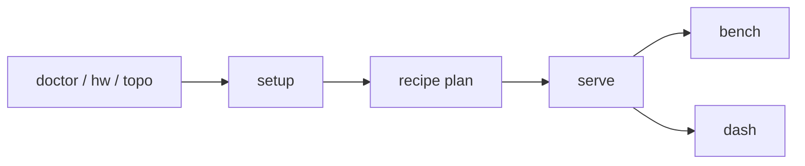

# rdnactl

Run vLLM on AMD ROCm GPUs without the guesswork.

rdnactl is one static binary. It checks your machine, tells you what is
missing, installs the stack, starts vLLM from a recipe, applies tuning,
benchmarks the server and shows it all in a web dashboard. Every feature is a
CLI command with `--json` output, so scripts and AI agents can drive it.



## Quick start

It is one file. Put it on the GPU host (Linux) and run it.

```bash
curl -fsSL https://raw.githubusercontent.com/opengfx1030/rdnactl/main/scripts/install.sh | sh
rdnactl          # what this machine has, what is missing, what to type next
rdnactl up       # check → install (non-root steps) → best recipe → serve → dashboard
```

`rdnactl up` asks once before it changes anything. It stops at steps that
need root and prints the command to run. Then it serves the best recipe for
your GPUs and opens the dashboard on `http://127.0.0.1:7860`.

### Step by step

Prefer control? Each stage is its own command:

```bash
rdnactl doctor                        # problems, each with the fix for your distro
rdnactl hw && rdnactl topo            # GPUs, PCIe switches, P2P
rdnactl setup apply --mode container  # install what is missing (root steps are printed)
rdnactl recipe list                   # recipes that fit this host
rdnactl recipe plan 27b-awq           # exact env + command, nothing runs
rdnactl serve 27b-awq                 # start it
rdnactl bench --concurrency 1,8       # measure it
rdnactl dash                          # watch it
```

Stop and inspect runs with `rdnactl ps`, `rdnactl logs -f`, `rdnactl stop`.

## Commands

| Command | What it does |
|---|---|
| `rdnactl` (`status`) | Overview of the host and the next command to type. |
| `up` | The whole path in one command, with one confirmation. |
| `doctor` | Checks GPU access, ROCm, libraries, Python venv, containers, resources, tuning. |
| `hw`, `topo` | GPU inventory; PCIe tree, link classes (PIX/PXB/PHB/SYS), P2P, bandwidth. |
| `setup plan\|apply` | Ordered install steps for this host. Never runs `sudo`. |
| `recipe list\|show\|plan\|validate` | Recipes, fit to this host, resolved launch. |
| `serve`, `ps`, `logs`, `stop` | Run vLLM as a host process or a Docker/Podman container. |
| `compose` | Write a `compose.yml` for a recipe (Docker and Podman). |
| `tune tunableop\|power` | TunableOp rows for your rocBLAS build; GPU power cap. |
| `bench` | Streaming benchmark: TTFT, ITL, decode/prefill/aggregate tok/s. |
| `dash` | Web dashboard over the same commands. |

Add `--json` to any command for machine-readable output.

## Documentation

- [docs/overview.html](docs/overview.html) — one-page visual tour (open in a browser).
- [docs/install.md](docs/install.md) — install: script, rpm/deb, container image, compose, source.
- [docs/spec.md](docs/spec.md) — the behavior contract: commands, JSON shapes, recipe schema, files.
- [docs/architecture.md](docs/architecture.md) — packages, dependencies, launch flow.
- [docs/roadmap.md](docs/roadmap.md) — what we build next, and what we decided not to build.
- [dashboard/README.md](dashboard/README.md) — the web UI: tabs, UX rules, files. Also [dashboard/AGENTS.md](dashboard/AGENTS.md) and [dashboard/CONTRIBUTING.md](dashboard/CONTRIBUTING.md).
- [docs/recipes.md](docs/recipes.md) — how to write and share a recipe.
- [CONTRIBUTING.md](CONTRIBUTING.md) — build, test, pull requests.
- [AGENTS.md](AGENTS.md) — rules for AI coding agents working in this repo.
- [gfx1030 wiki](https://blivioniag.github.io/gfx1030-wiki/) — hardware and ROCm background.

## Status

Draft 1. Validated hardware: 8× Radeon PRO V620 + 2× W7800 (Fedora 43,
ROCm 7.14). Recipes come from the
[opengfx1030/vllm-rdna](https://github.com/opengfx1030/vllm-rdna) fork, where
they were benchmarked. Reports from other hosts are welcome: attach
`rdnactl doctor --json` and `rdnactl hw --json` to the issue.

## License

Apache-2.0. See [LICENSE](LICENSE).
