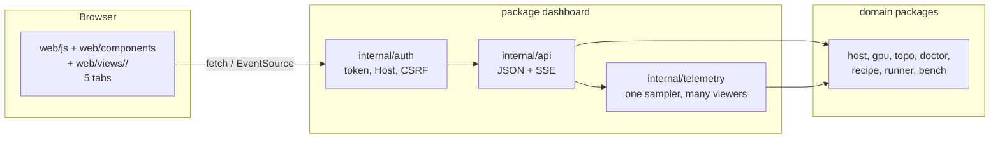

# Dashboard

The dashboard is a web page that shows one host: its GPUs, its servers and
their speed. It is a view of the CLI. It does not hold logic of its own.

Spec: [../docs/spec.md §11](../docs/spec.md#11-dashboard) is the contract for
the API. This page is the contract for the UI. Rules for agents are in
[AGENTS.md](AGENTS.md). Rules for contributors are in
[CONTRIBUTING.md](CONTRIBUTING.md).

Status: draft 1. We revisit this page when the UI changes.

## Run it

```bash
bernie dash                       # http://127.0.0.1:7860, this machine only
bernie dash --listen 0.0.0.0:7860 # other machines: a token is required
bernie up                         # starts it at the end of the setup path
```

On a non-loopback address the server prints a token. Open the page with
`/?token=<token>`. The details of the auth rules are in spec §11.

## How it works



- The UI calls the JSON API. It never reads the host directly.
- Each endpoint calls the same Go function as the matching CLI command. It
  returns the same JSON as `--json`.
- One sampler reads GPU and server data once per second. The hub sends it to
  every open page (server-sent events). Ten open tabs cost the same as one.
- The page is plain HTML, CSS and JavaScript. It is embedded in the binary.
  There is no build step, no npm and no framework.

## Files

| Path | Job |
|---|---|
| `server.go` | `Serve`: listener, routes, graceful stop. `/mcp` is MCP over HTTP (`internal/mcp`, spec §13.10) with its own guard |
| `doc.go` | The package contract: what the dashboard is and what it is not |
| `internal/api/` | One file per domain, one handler per endpoint in spec §11. `api.go` holds the routes |
| `internal/api/onboarding.go` | The onboarding endpoints: the checklist, the jobs and their event stream (spec §3.3) |
| `internal/auth/` | Token, loopback Host check, `X-Bernie` header on writes |
| `internal/telemetry/` | The 1 Hz sampler and the hub that shares it with every viewer |
| `internal/sse/` | The server-sent event writer and its line framing |
| `internal/httpjson/` | The JSON response shapes (the `--json` error shape, redaction) |
| `internal/support/redact` | Removes secrets from anything the API returns |
| `web/index.html` | Page shell: the rail, the tab bar, one section per tab |
| `web/js/core.js` | The DOM and formatting primitives: `h()`, `put()`, `bytes()`, `num()` |
| `web/js/shell.js` | The page-wide controls: the toast, the copy handler, the theme, the Advanced panels, the run status pill and the tab counts |
| `web/js/data.js` | The only place that fetches: `api()`, `apiText()`, the shared state, the SSE streams and the one poller |
| `web/js/boot.js` | The router, the old-hash aliases and the keyboard shortcuts. Loaded last. |
| `web/components/` | The shared widgets: cards, command block, charts, metrics, run table, step timeline |
| `web/views/<tab>/` | One file per concern of a tab: `viewSetup`, `viewDashboard`, `viewBenchmark`, `viewLogs`, `viewClassic` |
| `web/fonts/` | The self-hosted fonts (Latin subsets, OFL): Montserrat, Inter, JetBrains Mono. No CDN. |
| `web/css/tokens.css` | The two palettes (dark and light), the type, the fonts, the spacing and the radii |
| `web/css/layout.css` | The shell, the rail, the grids and the state headline |
| `web/css/components.css` | The buttons, the pills, the cards, the tables, the states and the toast |
| `web/css/views.css` | The parts that belong to one tab: the step timeline, the recipes, the doctor, the topology, the logs, the tiles and the rings |
| `web/css/bench.css` | The Benchmark tab only |
| `web/css/classic.css` | The Classic tab only: the reference-parity port, scoped under `.classic` |
| `dashboard_test.go` | API, auth and stream tests |

## The layout

```text
dashboard/
├── server.go            the server and the small public surface
├── doc.go               the package contract
├── internal/
│   ├── api/             one file per domain: hardware, topology, doctor,
│   │                    recipes, runs, onboarding, bench, power, telemetry
│   ├── auth/            the token, the Host check, the CSRF guard
│   ├── telemetry/       the sampler and the hub
│   ├── sse/             the event writer
│   └── httpjson/        the JSON response shapes
└── web/
    ├── index.html       the shell markup and the script order
    ├── css/             tokens, layout, components, views, bench, classic
    ├── fonts/           the self-hosted fonts and their licences
    ├── js/              core, shell, data, boot
    ├── components/      the shared widgets
    └── views/           setup/, dashboard/, benchmark/, logs/, classic/
```

The rule is the role, not the count: one package owns one thing, one file
owns one concern, and a directory holds the files of one role. Split a
directory when it holds two roles you can tell apart, not when it reaches a
number.

## Add a tab

1. Add the question the tab answers to the table below.
2. Add a `<section id="tab-<name>" data-tab-panel="<name>">` to
   `web/index.html` and a link with `data-tab="<name>"`.
3. Put the view in `web/views/<name>/`: one file per concern. The entry
   point is `view<Name>(root)`.
4. Register the view in the `views` map of `web/js/boot.js`. Keep the old
   hash names as aliases in the same map.
5. Add the endpoint it needs: spec §11, a handler in
   `dashboard/internal/api/<domain>.go`, the route in
   `dashboard/internal/api/api.go` and a test.

## Add a widget

1. Write the widget in `web/components/` when two tabs use it. Keep it in
   the view folder when only that tab uses it.
2. Build the DOM with `h()` from `web/js/core.js`. Never use `innerHTML`.
3. Read the data through `api()` from `web/js/data.js`. A view never calls
   `fetch` or opens an `EventSource` itself.
4. Take the colours from the `--` variables of `web/css/tokens.css`.
5. Show the unit and the range of every number. Show `–` when a number is
   missing.

## The five tabs

Each tab answers one question. Keep it that way.

| Tab | Question it answers | Data | Actions |
|---|---|---|---|
| Setup | Is this host ready, what do I do next, and what can it serve? | `/api/onboarding`, `/api/hw`, `/api/doctor`, `/api/recipes`, `.../plan` | run a step, start a run |
| Dashboard | How busy is the host, how is it wired, and what is serving? | `/api/telemetry`, `/api/hw`, `/api/power`, `/api/topo`, `/api/topo/check`, `/api/runs` | copy the card list, set a power cap |
| Benchmark | How fast is it, and does it read the whole prompt? | `/api/bench`, `/api/bench/suites`, `.../compare` | start a bench, compare two results |
| Logs | What is running, and why did it fail? | `/api/runs` (state, phase sentence), `.../logs` | stop, read logs, read the findings |
| Classic | What does the original reference design look like on this host? | `/api/telemetry`, `/api/gpus/history`, `/api/hw`, `/api/runs` | read only: stop the run, copy the URL, copy the snippet |

The Classic tab is the exception to "one question per tab": it is the
reference-parity port of the dashboard view of the reference web UI
(vllm-rdna-dash by CrispyGinger, used with permission), so the owner and the
author of the reference can put the two next to each other. It lives in
`web/views/classic/` with its own stylesheet `web/css/classic.css`, scoped
under `.classic`, and it adds no endpoint. It is the last tab of the rail.

The Setup tab is the first tab. It opens with the state of the machine in one
sentence, the facts of the host with the reason under every value, the
checklist of [spec §3.3](../docs/spec.md#33-the-onboarding-checklist): every
step of the path from a bare machine to a serving model, in order, and the
recipe chooser below it.

The old links still open their new home: `#overview` and `#home` open Setup,
`#recipes` opens Setup, `#gpus` and `#topology` open Dashboard, `#runs`
opens Logs and `#bench` opens Benchmark.

The checklist takes a moment to arrive: until it does, the headline says
what bernie is checking and the card names the phase. A checklist that is
older than its time to live is shown with the note that bernie is checking
the host again.

The Dashboard tab opens with five tiles: the load, the power, the memory, the
hottest card and the highest clock, each with the last minute of it as a
sparkline. Every card shows its load as a ring and its power as a meter
against the cap the card may draw. A number that was not measured shows `–`.
The PCIe topology and the power service follow as sections, and the run
overview closes the tab.

A step that bernie can do has a Run button. The step runs in the background
and its output goes under the step. A step that needs root has the command
and a copy button, and no Run button: bernie never runs a command as root.
The Advanced disclosure holds the raw document of the checklist and the
commands that produce it (`bernie status --steps`, `bernie status --json`).

`up` starts the dashboard before the server is healthy. The Logs tab then
shows the run as `starting`, says in words that the server is loading the
model, and follows the log of that run. The Setup tab shows the same
state in words.

The Benchmark tab answers one question: how fast is the server, and does it
read the whole prompt? It opens with the last result in one sentence, then
the suites as radio cards with their digest, the table of the cells (the
prefill and the decode speed, the time to the first token, the latency
between the tokens and the output rate, each with the mean, the median and
the 95th percentile), the curve of the prompt length, the comparison of two
results with a verdict on every group, the receipt of that comparison and
the history of the saved results. A number that was not measured shows `–`.
When the server has a `/metrics` endpoint, a line under the table says what
the server measured over the same requests. `Run the suite` starts the run
and the card under the suites follows it: the phase, the rate and the time.
The A/B section measures one server, then the other, then the first again.

## UI and UX rules

The rules live in [AGENTS.md](AGENTS.md): the hard rules, the structure
rules, the UI and UX rules, the Setup rules, the data display rules and the
front-end rules — each one with the check that proves it. This page keeps
the layout of the folder, the file table and the recipes.

## Copy and raw JSON

Every command on the page has a copy button. The button copies the exact
text of the command, so it can be pasted into a terminal as it is. The
button is `type="button"`, so it never submits a form next to it.

Every card has a `json` link in its header. It opens the raw JSON of the
endpoint behind the card in a new tab: the same document an agent gets
from the API. A card that shows no data has no link.

## The palette

The colours live in `web/css/tokens.css`, one block for the light palette and
one for the dark palette. The dark palette is the system preference; the
light one is the override. Every pair is at or above WCAG AA: 4.5:1 for
text, 3:1 for large text and for the edges of the controls.

The tokens are `--bg`, `--surface`, `--surface-2`, `--surface-3`,
`--border`, `--border-strong`, `--text`, `--text-2`, `--muted`, `--accent`,
`--on-accent`, `--key`, `--ok`, `--warn`, `--fail`, `--skip`, `--info` and
the five `--series-1` to `--series-5`.

The old single stylesheet used `--panel`, `--fg`, `--line`, `--code`,
`--bar` and `--spark`. They are gone: the files use the new names.

What changed on purpose when the palette was rebuilt:

| What | Before | Now | Why |
|---|---|---|---|
| The accent, light | `#c8102e` | `#b3122c` | A little darker, so white text on it stays above AA. |
| The accent, dark | `#ff5c6c` | `#ff5c6c` | Unchanged. |
| The text on the accent, dark | white | `--on-accent` (`#16181c`) | White on the light red was 2.6:1. Dark text on it is 5.9:1. |
| The muted text, light | `#667085` | `#5f6874` | The old value was 4.2:1 on the tinted surface of a command block. |
| The skip colour | `#8c959f` / `#6e7681` | `#5f6874` / `#7d8590` | The word carries the meaning; the colour only helps. |
| The warning, light | `#9a6700` | `#8a6100` | A little darker, so it stays above AA on white. |
| The failure, light | `#cf222e` | `#b42318` | The same. |
| The topology classes | four fixed colours | `--series-1` to `--series-5` | The four classes now use the same series as the charts. |

## Safe by default

- Loopback only unless you pass `--listen`. Non-loopback needs a token.
- Writes need the `X-Bernie: 1` header. A form on another site cannot send it.
- The page builds DOM with `h()` and never uses `innerHTML`. Server data is
  text, never markup.
- `internal/support/redact` removes tokens and keys from every response.

## Known gaps (revisit)

| Gap | Idea |
|---|---|
| No settings view | Show `config.yaml` values and where they come from |
| No log-error help in the Logs tab | Show the matched rule (id, cause, fix) from the log doctor |
| No demo mode | Serve a fixture host so people can try the UI without GPUs |
| Mobile layout is basic | Check each tab at 390 px wide |
| No screenshot tests | Add a headless-browser smoke test for the five tabs |
