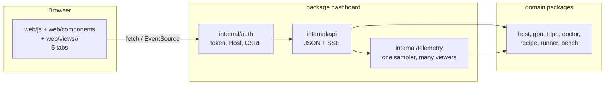

# Dashboard

The dashboard is a web page that shows one host: its GPUs, its servers and
their speed. It is a view of the CLI. It does not hold logic of its own.

Spec: [../docs/spec.md §11](../docs/spec.md#11-dashboard) is the contract for
the API. This page is the contract for the UI. Rules for agents are in
[AGENTS.md](AGENTS.md). Rules for contributors are in
[CONTRIBUTING.md](CONTRIBUTING.md).

Status: draft 1. We revisit this page when the UI changes.

## Run it

```bash
bernie dash                       # http://127.0.0.1:7860, this machine only
bernie dash --listen 0.0.0.0:7860 # other machines: a token is required
bernie up                         # starts it at the end of the setup path
```

On a non-loopback address the server prints a token. Open the page with
`/?token=<token>`. The details of the auth rules are in spec §11.

## How it works



- The UI calls the JSON API. It never reads the host directly.
- Each endpoint calls the same Go function as the matching CLI command. It
  returns the same JSON as `--json`.
- One sampler reads GPU and server data once per second. The hub sends it to
  every open page (server-sent events). Ten open tabs cost the same as one.
- The page is plain HTML, CSS and JavaScript. It is embedded in the binary.
  There is no build step, no npm and no framework.

## Files

| Path | Job |
|---|---|
| `server.go` | `Serve`: listener, routes, graceful stop. `/mcp` is MCP over HTTP (`internal/mcp`, spec §13.10) with its own guard |
| `doc.go` | The package contract: what the dashboard is and what it is not |
| `internal/api/` | One file per domain, one handler per endpoint in spec §11. `api.go` holds the routes |
| `internal/api/onboarding.go` | The onboarding endpoints: the checklist, the jobs and their event stream (spec §3.3) |
| `internal/auth/` | Token, loopback Host check, `X-Bernie` header on writes |
| `internal/telemetry/` | The 1 Hz sampler and the hub that shares it with every viewer |
| `internal/sse/` | The server-sent event writer and its line framing |
| `internal/httpjson/` | The JSON response shapes (the `--json` error shape, redaction) |
| `internal/support/redact` | Removes secrets from anything the API returns |
| `web/index.html` | Page shell: the rail, the tab bar, one section per tab |
| `web/js/core.js` | The DOM and formatting primitives: `h()`, `put()`, `bytes()`, `num()` |
| `web/js/theme.js` | The theme of the page: the choice of the reader (`Auto`, `Dark`, `Light`) and the palette it puts on `<html>`. Loaded in the head, before the first paint |
| `web/js/shell.js` | The page-wide controls: the toast, the copy handler, the Advanced panels, the run status pill and the tab counts |
| `web/js/data.js` | The only place that fetches: `api()`, `apiText()`, the shared state, the SSE streams and the one poller |
| `web/js/boot.js` | The router, the old-hash aliases, the keyboard shortcuts and the manifest of the files of a tab. Loaded last. |
| `web/components/` | The shared widgets: cards, command block, charts, metrics, comparison, step timeline |
| `web/views/<tab>/` | One file per concern of a tab: `viewSetup`, `viewDashboard`, `viewChat`, `viewBenchmark`, `viewTopology`, `viewFleet`, `viewLogs`, `viewAdvanced` |
| `web/views/topology/topology.css` | The Topology tab only: the matrix, the legend, the tree and the checklist |
| `web/views/chat/chat.css` | The Chat tab only: the prompt box, the answer and the numbers of the answer |
| `web/views/fleet/fleet.css` | The Fleet tab only: the rows of the other hosts and the form that adds one |
| `web/fonts/` | The self-hosted fonts (Latin subsets, OFL): Montserrat, Inter, JetBrains Mono. No CDN. |
| `web/css/tokens.css` | The two palettes (dark and light), the type, the fonts, the spacing and the radii |
| `web/css/layout.css` | The shell, the rail, the grids and the state headline |
| `web/css/components.css` | The buttons, the pills, the cards, the tables, the meters, the tiles and the states every card can be in |
| `web/css/overlays.css` | The toast, the tooltip and the spinner: the parts of the page that come and go |
| `web/css/views.css` | The parts that belong to one tab: the step timeline, the recipes, the doctor, the logs, the tiles and the rings |
| `web/css/bench.css` | The Benchmark tab only |
| `web/css/advanced.css` | The Advanced tab only: the doctor report of the console and the raw documents |
| `dashboard_test.go` | API, auth and stream tests |

## Published globals

Every file in `web/` is a classic script loaded in the order of
`web/index.html`. It publishes its top-level names. The table below lists
them. `scripts/check-web.sh` fails when the tree and this table disagree.

Regenerate the table rows with `scripts/check-web.sh --print-globals`.

| File | Published globals |
|---|---|
| `dashboard/web/components/cards.js` | `jsonLink`, `cardHead`, `stateHead`, `setHead`, `factRow`, `tableHead`, `tableCaption`, `emptyState`, `sectionLabel`, `PILL_ICON`, `statePill`, `loading`, `failed` |
| `dashboard/web/components/charts.js` | `chartMinMax`, `chartNumbers`, `chartSame`, `chartPaths`, `chartPointer`, `chartNice`, `sparkDomain`, `chartDataTable`, `spark`, `areaChart`, `ring`, `meter` |
| `dashboard/web/components/command.js` | `copyBtn`, `cmdBlock`, `connectEndpoint`, `connectSnippet` |
| `dashboard/web/components/compare.js` | `NO_VERDICT`, `svgEl`, `ladderPoints`, `compareCellName`, `compareSpread`, `compareBandText`, `compareSpreadText`, `compareChipText`, `compareChipWidth`, `compareChip`, `compareBlock`, `compareScale`, `compareTable`, `compareChart`, `curveSmallMultiples`, `curveTable` |
| `dashboard/web/components/gputable.js` | `gpuValueTable` |
| `dashboard/web/components/metrics.js` | `METRIC_HELP`, `VERDICTS`, `METRIC_COLS`, `COMPARE_METRICS`, `benchNum`, `benchDist`, `benchRate`, `benchDigits`, `SPREAD_STEADY`, `benchSpreadText`, `cellLens`, `cellFlags`, `metricHead`, `cellRow`, `cellsTable`, `verdictChip` |
| `dashboard/web/components/timeline.js` | `TIMELINE_STATE_WORD`, `TIMELINE_MARK`, `TIMELINE_PILL`, `stepTimeline`, `stepCurrentID`, `stepRow`, `stepPill`, `stepMark`, `stepSummary`, `stepActionLabel`, `stepAction`, `stepProgressNode`, `stepBar`, `stepProblem`, `stepToggleLog` |
| `dashboard/web/js/boot.js` | `VIEWS`, `OLD_ROUTES`, `TAB_SCRIPTS`, `TAB_CSS`, `tabReady`, `tabLoading`, `loadScript`, `loadStyle`, `openTab`, `parseHash`, `route`, `preparePanel`, `focusSection`, `tabsKey`, `pendingG`, `shortcutsKey`, `boot` |
| `dashboard/web/js/core.js` | `h`, `add`, `put`, `$`, `GiB`, `bytes`, `num`, `ago`, `badge`, `sh`, `SVG_NS`, `chartSvg` |
| `dashboard/web/js/data.js` | `HISTORY`, `RUN_POLL_MS`, `MAX_POLL_MS`, `STALE_MS`, `state`, `request`, `api`, `loadHW`, `runsOf`, `runURL`, `pushHist`, `slowAgeNote`, `openTelemetry`, `openRunLogs`, `openJobEvents`, `openBenchEvents`, `JOB_POLL_MS`, `watchBenchJob`, `apiText`, `frameJobs`, `frameHandle`, `frameFallback`, `FRAME_FALLBACK_MS`, `runFrameJobs`, `onFrame`, `frameSubs`, `onTabFrame`, `telemetryStream`, `pollTimer`, `pollDelay`, `pollCycle`, `startTelemetry`, `pollRuns`, `pollCounts`, `schedulePoll`, `startPolling` |
| `dashboard/web/js/shell.js` | `ADVANCED_KEY`, `toastTimer`, `toast`, `copyText`, `copy`, `copySource`, `tipPanel`, `openTip`, `tooltip`, `closeTip`, `setTabCount`, `SHORTCUT_KEY`, `SHORTCUTS`, `shortcutsOn`, `setShortcuts`, `shortcutsText`, `advancedOn`, `applyAdvanced`, `applyAdvancedToNew`, `toggleAdvanced`, `setRunPill`, `setPillAge`, `phaseSentence` |
| `dashboard/web/js/theme.js` | `THEME_KEY`, `THEME_CHOICES`, `themeChoice`, `systemDark`, `applyTheme`, `setTheme`, `watchSystemTheme` |
| `dashboard/web/views/advanced/console.js` | `adv`, `viewAdvanced`, `advLoad`, `advReload`, `advPaint`, `advHead`, `advSubscribe`, `advRunsTable`, `advCardListText`, `advCopyCardList`, `advServerMeasures` |
| `dashboard/web/views/advanced/doctor.js` | `advDoctorReport`, `advDoctorCheck` |
| `dashboard/web/views/advanced/documents.js` | `advDocuments`, `advLoadDocuments`, `advDocument` |
| `dashboard/web/views/advanced/jobs.js` | `advJobList`, `advJobState` |
| `dashboard/web/views/advanced/prefs.js` | `advPrefsCard`, `prefsList`, `prefRow`, `setResolved`, `savePref` |
| `dashboard/web/views/advanced/report.js` | `advReportCard`, `advReportText`, `advCopyReport`, `advDownloadReport` |
| `dashboard/web/views/advanced/power.js` | `advPowerCard`, `advPaintPower`, `advPowerRow`, `advSavePower` |
| `dashboard/web/views/benchmark/benchmark.js` | `benchState`, `benchSection`, `benchFailed`, `benchResults`, `benchSuiteLine`, `benchCards`, `benchCellName`, `benchBestCell`, `benchHeadline`, `benchResultBody`, `benchCopy`, `benchReceipt`, `benchStartError`, `viewBenchmark` |
| `dashboard/web/views/benchmark/suites.js` | `benchSuiteCells`, `benchSuiteEstS`, `benchMinutes`, `benchSuiteCard`, `benchSuiteCards`, `benchSentence`, `benchProgress`, `benchBest`, `benchSuiteOf`, `benchHistoryRow`, `benchHistory`, `benchAB`, `benchAdvanced` |
| `dashboard/web/views/chat/chat.js` | `chatState`, `viewChat` |
| `dashboard/web/views/dashboard/dashboard.js` | `dash`, `dashSection`, `dashInfo`, `dashGroup`, `dashPush`, `dashSeries`, `dashCardSeries`, `dashCardName`, `dashLiveRun`, `dashPhase`, `dashLoad`, `dashUpdateSimple`, `dashHistory`, `dashWindowSeries`, `viewDashboard`, `dashSample` |
| `dashboard/web/views/dashboard/details.js` | `DASH_DETAIL_WINDOWS`, `dashDetails`, `dashLoadDetails`, `dashDetailsRead`, `dashDetailsWindow`, `dashWindowMinutes`, `dashDetailsPower`, `dashDetailsDocuments` |
| `dashboard/web/views/dashboard/gpus.js` | `dashTile`, `dashCard`, `dashEcc`, `dashCards`, `renderGPUs`, `dashSubscribe` |
| `dashboard/web/views/dashboard/simple.js` | `dashSimpleHero`, `dashStopRun`, `dashMeaning`, `dashSimpleTiles`, `dashSimpleCharts`, `dashSimpleMachine`, `dashBuildSimple`, `dashSimpleConnect` |
| `dashboard/web/views/fleet/fleet.js` | `FLEET_STATE_WORD`, `fleetStatePill`, `fleetGPUs`, `fleetRow`, `fleetShare`, `viewFleet` |
| `dashboard/web/views/logs/advanced.js` | `logsJsonLink`, `logsAdvanced` |
| `dashboard/web/views/logs/findings.js` | `logPill`, `logSeverityPill`, `logFixIsCommand`, `logFinding`, `logFindings` |
| `dashboard/web/views/logs/levels.js` | `LOG_ERROR_MARKS`, `LOG_WARN_MARKS`, `LOG_LEVEL_WORDS`, `logLevel`, `logLevelWord` |
| `dashboard/web/views/logs/logs.js` | `logsTail`, `logsRun`, `stopLogs`, `logSection`, `logRuns`, `viewLogs`, `followLogs`, `stopRun` |
| `dashboard/web/views/logs/picker.js` | `logRunState`, `logRunPicker` |
| `dashboard/web/views/logs/tail.js` | `LOG_MAX_LINES`, `LOG_FILTER_LEVELS`, `logCount`, `logTail` |
| `dashboard/web/views/setup/advanced.js` | `setupAdvancedPanel`, `loadSetupAdvanced`, `setupAdvancedDocument` |
| `dashboard/web/views/setup/chooser.js` | `setupRecipeCard`, `setupPaintRecipeList`, `setupSelectRecipe`, `setupPaintRecipeSelection` |
| `dashboard/web/views/setup/facts.js` | `paintSetupFacts`, `setupFactList`, `setupFact`, `setupFactsFromHost`, `setupMemoryWhy`, `setupPlanSentence`, `setupLoadHW`, `setupLoadDoctorReport` |
| `dashboard/web/views/setup/glossary.js` | `paintSetupGlossary` |
| `dashboard/web/views/setup/headline.js` | `setupHeadline`, `setupServerEndpoint`, `setupHeadActions`, `setupNextRunnable`, `setupCurrentStep`, `setupRunNextStep`, `setupExplainWait`, `setupWaitSentence`, `pathSteps`, `setupRootCommand`, `setupCopyNextCommand`, `setupCopyText`, `startSetupServer`, `focusSetupStep`, `focusSetupDoctor`, `focusSetupVerify`, `setupShowDetails` |
| `dashboard/web/views/setup/path.js` | `setupRunPath`, `setupStopPath`, `setupAttachPath`, `setupPaintPath` |
| `dashboard/web/views/setup/recipes.js` | `loadSetupRecipes`, `setupRecipeOrder`, `setupRecipeError`, `setupRecommendedCard`, `setupRecommendedRecipe`, `setupFitStatus`, `setupFitLine`, `loadSetupPlan`, `setupRecipe`, `setupPlanView`, `setupPlanActions`, `setupPlanReady`, `setupPlanCommand`, `setupQuote`, `setupPlanSettings`, `setupPlanAdjustments`, `setupPlanOverrides`, `setupSetValue`, `setupExtraSets`, `setupApplyOverrides`, `setupSwitchMode`, `startSetupRecipe`, `paintSetupRecipeHint`, `setupRecommendationWhy`, `setupRecipeNote`, `setupRecipeLabel` |
| `dashboard/web/views/setup/setup.js` | `SETUP_EXTRA_STEPS`, `SETUP_SMOKE_ENABLED`, `setupState`, `viewSetup`, `setupEnsureModule`, `setupStartPath`, `loadSetupDocument`, `paintSetupHead`, `paintSetupStale`, `paintSetupError`, `paintSetupTimeline`, `setupStepLink`, `setupStepNote`, `setupEstimateNote`, `loadSetupDoctor`, `setupDoctorFinding`, `setupVerifyBox`, `setupServerRunning`, `setupServerServing`, `setupAskServer` |
| `dashboard/web/views/setup/steps.js` | `setupProgress`, `setupLogs`, `setupStreams`, `setupJobRead`, `runSetupStep`, `followSetupJob`, `loadSetupJobProgress`, `setupJobStart`, `setupApplyJobProgress`, `setupProgressPercent`, `setupProgressSentence`, `setupProgressDetail`, `setupElapsed`, `setupElapsedText`, `setupLiveDetail`, `setupRate`, `setupDuration`, `attachSetupJobs`, `attachSetupJob`, `paintSetupProgress`, `setupStopStreams` |
| `dashboard/web/views/topology/advanced.js` | `topoBandwidth`, `topoAdvanced` |
| `dashboard/web/views/topology/checklist.js` | `topoChecklist` |
| `dashboard/web/views/topology/links.js` | `topoLegend`, `topoTree` |
| `dashboard/web/views/topology/matrix.js` | `TOPO_CLASS_WORD`, `TOPO_CLASS_ORDER`, `topoClassWords`, `topoMatrix`, `topoPairTable` |
| `dashboard/web/views/topology/topology.js` | `topo`, `topoSection`, `viewTopology`, `topoLoad`, `topoCheck`, `topoPaint`, `topoSetHead` |

## The layout

```text
dashboard/
├── server.go            the server and the small public surface
├── doc.go               the package contract
├── internal/
│   ├── api/             one file per domain: hardware, topology, doctor,
│   │                    recipes, runs, onboarding, bench, power, telemetry
│   ├── auth/            the token, the Host check, the CSRF guard
│   ├── telemetry/       the sampler and the hub
│   ├── sse/             the event writer
│   └── httpjson/        the JSON response shapes
└── web/
    ├── index.html       the shell markup and the script order
    ├── css/             tokens, layout, components, overlays, views, bench, advanced
    ├── fonts/           the self-hosted fonts and their licences
    ├── js/              core, theme, shell, data, boot
    ├── components/      the shared widgets
    └── views/           setup/, dashboard/, benchmark/, logs/, advanced/
```

The rule is the role, not the count: one package owns one thing, one file
owns one concern, and a directory holds the files of one role. Split a
directory when it holds two roles you can tell apart, not when it reaches a
number.

## Add a tab

1. Add the question the tab answers to the table below.
2. Add a `<section id="tab-<name>" data-tab-panel="<name>">` to
   `web/index.html` and a link with `data-tab="<name>"`.
3. Put the view in `web/views/<name>/`: one file per concern. The entry
   point is `view<Name>(root)`.
4. Register the view in the `views` map of `web/js/boot.js`. Keep the old
   hash names as aliases in the same map.
5. Add the endpoint it needs: spec §11, a handler in
   `dashboard/internal/api/<domain>.go`, the route in
   `dashboard/internal/api/api.go` and a test.

## Add a widget

1. Write the widget in `web/components/` when two tabs use it. Keep it in
   the view folder when only that tab uses it.
2. Build the DOM with `h()` from `web/js/core.js`. Never use `innerHTML`.
3. Read the data through `api()` from `web/js/data.js`. A view never calls
   `fetch` or opens an `EventSource` itself.
4. Take the colours from the `--` variables of `web/css/tokens.css`.
5. Show the unit and the range of every number. Show `–` when a number is
   missing.

## The eight tabs

Each tab answers one question. Keep it that way.

| Tab | Question it answers | Data | Actions |
|---|---|---|---|
| Setup | Is this host ready, what do I do next, and what can it serve? | `/api/onboarding`, `/api/hw`, `/api/doctor`, `/api/recipes`, `.../plan` | run a step, start a run |
| Dashboard | Is it serving, how fast is it, and how does an app connect? | `/api/telemetry`, `/api/hw`, `/api/runs`, `/api/glossary`, `/api/gpus/history` | copy the URL, stop the run, copy a curl or Python request |
| Chat | What will I ask the model? | `/api/chat`, `/api/runs` | send one prompt, stop the answer |
| Benchmark | How fast is it, and does it read the whole prompt? | `/api/bench`, `/api/bench/suites`, `.../compare` | start a bench, compare two results |
| Topology | Can the cards copy to each other? | `/api/topo`, `/api/topo/check` | check the readiness again |
| Fleet | What do the other hosts do? | `/api/fleet`, `/api/report` | add a host, forget a host, copy the redacted report, open that host's own dashboard |
| Logs | What is running, and why did it fail? | `/api/runs` (state, phase sentence), `.../logs` | stop, read logs, read the findings |
| Advanced | What can I inspect and change on this host? | `/api/hw`, `/api/doctor`, `/api/power`, `/api/runs`, `/api/jobs`, `/api/telemetry` | write the power cap, re-check the host |

The Advanced tab is the operator's console: the things about the host that
belong to no single tab. It holds the exact per-GPU table (the same one the
Dashboard tab shows in its details), the power caps with the only write of
the page, the doctor report in full (every category, every check), the jobs
of the host, the run record with the measures of the server, and the raw
documents of every endpoint it reads. The old first-dashboard layout is gone
from it: the tiles and the cards are on the Dashboard tab, the PCIe tree and
the P2P checklist are on the Topology tab, and the known problems are on the
Logs tab. It lives in `web/views/advanced/`, it reads the same `/api/*`
answers and the shared telemetry stream, and it adds no endpoint. The old
route `#classic` still lands on it.

The Setup tab is the first tab. It opens with the state of the machine in one
sentence, the facts of the host with the reason under every value, the
checklist of [spec §3.3](../docs/spec.md#33-the-onboarding-checklist): every
step of the path from a bare machine to a serving model, in order, and the
recipe chooser below it.

The old links still open their new home: `#overview` and `#home` open Setup,
`#recipes` opens Setup, `#gpus` opens Dashboard, `#topology` opens the
Topology tab, `#runs` opens Logs and `#bench` opens Benchmark.

The checklist takes a moment to arrive: until it does, the headline says
what bernie is checking and the card names the phase. A checklist that is
older than its time to live is shown with the note that bernie is checking
the host again.

The Dashboard tab is the clear operational view. It opens with one hero:
the state in one big word, the plain sentence, the endpoint with **Copy
URL**, the Stop action and the output speed with its unit. Six plain-language
tiles follow: prompt reading, active requests, first token, KV cache, prefix
cache hits and draft accepted. Every tile has an `(i)` explanation from the
shared glossary and a human subtitle; a value this host cannot measure is `–`
and says `n/a on this host`. Two five-minute charts show the output and
prompt rates, then come one card per GPU, **This machine** and **Connect an
app** with copyable curl and Python requests. The Advanced tab keeps the
fleet telemetry, the exact per-GPU table, the power controls, the topology
and the raw documents.

A step that bernie can do has a Run button. The step runs in the background
and its output goes under the step. A step that needs root has the command
and a copy button, and no Run button: bernie never runs a command as root.
The Advanced disclosure holds the raw document of the checklist and the
commands that produce it (`bernie status --steps`, `bernie status --json`).

`up` starts the dashboard before the server is healthy. The Logs tab then
shows the run as `starting`, says in words that the server is loading the
model, and follows the log of that run. The Setup tab shows the same
state in words.

The Benchmark tab answers one question: how fast is the server, and does it
read the whole prompt? It opens with the last result in one sentence, then
the suites as radio cards with their digest, the table of the cells (the
prefill and the decode speed, the time to the first token, the latency
between the tokens and the output rate, each with the mean, the median and
the 95th percentile), the curve of the prompt length, the comparison of two
results with a verdict on every group, the receipt of that comparison and
the history of the saved results. A number that was not measured shows `–`.
When the server has a `/metrics` endpoint, a line under the table says what
the server measured over the same requests. `Run the suite` starts the run
and the card under the suites follows it: the phase, the rate and the time.
The A/B section measures one server, then the other, then the first again.

## UI and UX rules

The rules live in [AGENTS.md](AGENTS.md): the hard rules, the structure
rules, the UI and UX rules, the Setup rules, the data display rules and the
front-end rules — each one with the check that proves it. This page keeps
the layout of the folder, the file table and the recipes.

## Copy and raw JSON

Every command on the page has a copy button. The button copies the exact
text of the command, so it can be pasted into a terminal as it is. The
button is `type="button"`, so it never submits a form next to it.

Every card has a `json` link in its header. It opens the raw JSON of the
endpoint behind the card in a new tab: the same document an agent gets
from the API. A card that shows no data has no link.

## The palette

The colours live in `web/css/tokens.css`, one block for the light palette and
one for the dark palette. The dark palette is the base of the stylesheet;
the light one is the override. Every pair is at or above WCAG AA: 4.5:1 for
text, 3:1 for large text and for the edges of the controls.

The tokens are `--bg`, `--surface`, `--surface-2`, `--surface-3`,
`--border`, `--border-strong`, `--text`, `--text-2`, `--muted`, `--accent`,
`--on-accent`, `--key`, `--ok`, `--warn`, `--fail`, `--skip`, `--info` and
the five `--series-1` to `--series-5`.

The old single stylesheet used `--panel`, `--fg`, `--line`, `--code`,
`--bar` and `--spark`. They are gone: the files use the new names.

What changed on purpose when the palette was rebuilt:

| What | Before | Now | Why |
|---|---|---|---|
| The accent, light | `#c8102e` | `#b3122c` | A little darker, so white text on it stays above AA. |
| The accent, dark | `#ff5c6c` | `#ff5c6c` | Unchanged. |
| The text on the accent, dark | white | `--on-accent` (`#16181c`) | White on the light red was 2.6:1. Dark text on it is 5.9:1. |
| The muted text, light | `#667085` | `#5f6874` | The old value was 4.2:1 on the tinted surface of a command block. |
| The skip colour | `#8c959f` / `#6e7681` | `#5f6874` / `#7d8590` | The word carries the meaning; the colour only helps. |
| The warning, light | `#9a6700` | `#8a6100` | A little darker, so it stays above AA on white. |
| The failure, light | `#cf222e` | `#b42318` | The same. |
| The topology classes | four fixed colours | `--series-1` to `--series-5` | The four classes now use the same series as the charts. |

## The theme

The rail holds the three choices of the theme, in words: `Auto`, `Dark` and
`Light`. `Auto` is the default: the page follows the system
(`prefers-color-scheme`) and follows it live, so a laptop that changes its
palette at sunset changes the page with it. `Dark` and `Light` are the two
palettes of the reference, as overrides. The choice is remembered in
`localStorage` (`bernie.theme`) and the palette goes on `<html>` as
`data-theme="dark"` or `data-theme="light"`.

`web/js/theme.js` is loaded in the head of the page: the palette is set
before the stylesheets paint, so the page never shows the other one for a
moment. The three buttons carry `aria-pressed`, and the choice is said out
loud in a live region (`role="status"`): `The theme follows the system.` or
`The theme is dark.`

## The budget of the page

Two numbers matter. The **first paint** is what the reader waits for: it
holds the shell and the Setup tab, and nothing else. The **whole tree** is
what the binary carries: the code of the four closed tabs is in it too, and
it arrives when the reader asks for it.

The first paint is measured by the browser against the built binary
(2026-10-29, the tree of `a3bd238`):

| What | Before | Now |
|---|---|---|
| Requests | 43 | **21** (1 HTML + 4 CSS + 12 scripts + 4 fonts) |
| Text | 341.8 KB | **147.4 KB** |
| Text, gzipped | 110.3 KB | **46.4 KB** |

A tab that opens for the first time brings its own files (6–8 requests,
once). The manifest that names them is in `web/js/boot.js`.

The server answers the endpoints that read the host from one cache with a
short time to live (`dashboard/internal/api/cache.go`). On the 10 GPU box
the first read of `/api/doctor` costs 348 ms and every read inside the
time to live costs 10 ms.

The telemetry stream is the one thing that costs while the page is open:
the sampler reads the cards of the host once per second, and every read of
an amdgpu attribute waits for its card. The attributes are read in two
tiers (the load, the memory and the power every second; the
temperatures, the caps and the clocks every four seconds), the cards are
read in parallel, and the hwmon node and the sensor labels are remembered.
On the 10 GPU box that is **46 reads of `/sys` per second** and **6.4 % of
one core** of `bernie dash` while a page watches `/api/telemetry` (it was
16.7 % before the tiers). The dashboard with no page open costs nothing:
the sampler runs only while a page watches the stream, and three pages
cost the same as one (the hub shares the sample).

The rules and the numbers are in [AGENTS.md](AGENTS.md) (the budget table)
and in [../docs/design-dashboard.md §8.3](../docs/design-dashboard.md#83-performance)
(the measured before and after).

## Safe by default

- Loopback only unless you pass `--listen`. Non-loopback needs a token.
- Writes need the `X-Bernie: 1` header. A form on another site cannot send it.
- The page builds DOM with `h()` and never uses `innerHTML`. Server data is
  text, never markup.
- `internal/support/redact` removes tokens and keys from every response.

## Known gaps (revisit)

| Gap | Idea |
|---|---|
| No settings view | Show `config.yaml` values and where they come from |
| No log-error help in the Logs tab | Show the matched rule (id, cause, fix) from the log doctor |
| No demo mode | Serve a fixture host so people can try the UI without GPUs |
| Mobile layout is basic | Check each tab at 390 px wide |
| No screenshot tests | Add a headless-browser smoke test for the eight tabs |
