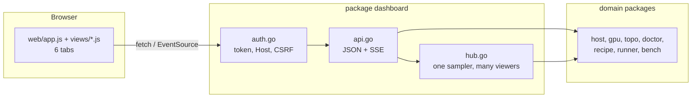

# Dashboard

The dashboard is a web page that shows one host: its GPUs, its servers and
their speed. It is a view of the CLI. It does not hold logic of its own.

Spec: [../docs/spec.md §11](../docs/spec.md#11-dashboard) is the contract for
the API. This page is the contract for the UI. Rules for agents are in
[AGENTS.md](AGENTS.md). Rules for contributors are in
[CONTRIBUTING.md](CONTRIBUTING.md).

Status: draft 1. We revisit this page when the UI changes.

## Run it

```bash
bernie dash                       # http://127.0.0.1:7860, this machine only
bernie dash --listen 0.0.0.0:7860 # other machines: a token is required
bernie up                         # starts it at the end of the setup path
```

On a non-loopback address the server prints a token. Open the page with
`/?token=<token>`. The details of the auth rules are in spec §11.

## How it works



- The UI calls the JSON API. It never reads the host directly.
- Each endpoint calls the same Go function as the matching CLI command. It
  returns the same JSON as `--json`.
- One sampler reads GPU and server data once per second. The hub sends it to
  every open page (server-sent events). Ten open tabs cost the same as one.
- The page is plain HTML, CSS and JavaScript. It is embedded in the binary.
  There is no build step, no npm and no framework.

## Files

| Path | Job |
|---|---|
| `dashboard.go` | `Serve`: listener, routes, graceful stop. `/mcp` is MCP over HTTP (`internal/mcp`, spec §13.10) with its own guard |
| `api.go` | One handler per endpoint in spec §11 |
| `onboarding.go` | The onboarding endpoints: the checklist, the jobs and their event stream (spec §3.3) |
| `auth.go` | Token, loopback Host check, `X-Bernie` header on writes |
| `hub.go`, `telemetry.go`, `sse.go` | 1 Hz samples and event streams |
| `internal/support/redact` | Removes secrets from anything the API returns |
| `web/index.html` | Page shell: header, tab bar, one section per tab |
| `web/app.js` | Core: helpers (`h()`, `api()`, `copyBtn()`, `cmdBlock()`), shared state, telemetry stream |
| `web/views/<tab>.js` | One file per tab: `viewOverview`, `viewGPUs`, ... |
| `web/boot.js` | Router and start-up. Loaded last. |
| `web/tokens.css` | The two palettes (light and dark), the type, the spacing and the radii |
| `web/layout.css` | The shell, the grids, the cards and the state headline |
| `web/components.css` | The badges, the buttons, the tables, the meters, the tiles and the ring |
| `dashboard_test.go` | API, auth and stream tests |

## The six tabs

Each tab answers one question. Keep it that way.

| Tab | Question it answers | Data | Actions |
|---|---|---|---|
| Overview | Is this host ready, and what do I do next? | `/api/hw`, `/api/doctor`, `/api/runs` | none |
| GPUs | How busy, how hot and at which clock is each GPU? | `/api/telemetry`, `/api/hw` | none |
| Topology | Which GPUs talk fast to which, and will P2P work? | `/api/topo`, `/api/topo/check` | none |
| Recipes | What can I serve, and what will it run? | `/api/recipes`, `.../plan` | start a run |
| Runs | What is running, and why did it fail? | `/api/runs` (state, phase sentence), `.../logs` | stop, read logs |
| Bench | How fast is it, and does it read the whole prompt? | `/api/bench` | start a bench |

`up` starts the dashboard before the server is healthy. The Runs tab then
shows the run as `starting`, says in words that the server is loading the
model, and follows the log of that run. The Overview tab shows the same
state in words.

The Bench tab shows one table per cell: the prefill and the decode speed
(the rate of the whole cell and the distribution of the rates of its
requests), the time to first token in seconds, the inter-token latency in
milliseconds and the output rate. A number that was not measured shows `–`.
When the server has a `/metrics` endpoint, a line under the table says what
the server measured over the same requests. The history lists the best
output, decode and prefill rate of every saved result.

## UI and UX rules

The goal: a person who has never used vLLM understands the page in one
minute. An agent can read the same page as text.

1. **One question per tab.** If a tab needs two answers, split it.
2. **Say the state in words first.** A badge (`ok`, `warn`, `fail`, `skip`)
   has a word. Color never carries the meaning alone.
3. **Every problem has a fix next to it.** Show the cause and the command to
   run. A copy button sits on every command. Never show a bare error code.
4. **Next step is always visible.** The Overview tab shows one next command
   for the current state (no GPU, no recipe fits, ready to serve, starting,
   running). Every tab has at most one primary button; the rest are ghost
   buttons.
5. **Numbers have units and a range.** `18.2 / 29.4 GiB`, not `18.2`. A
   missing value shows `–`, never `0` or `NaN`.
6. **Show what will happen before it happens.** A start button shows the plan
   (command, GPUs, port) first. It does not start on the first click.
7. **Slow work shows progress.** Server start and downloads can take minutes.
   Show one plain sentence ("Loading weights, 4 of 8 GPUs ready") and the log.
   Do not show a spinner alone.
8. **Empty states teach.** No runs? Say what a run is and show the command to
   start one.
9. **Same data as the CLI.** A value on the page also exists in `--json`
   output with the same name. If it does not, add it to the CLI first.
10. **Fast and small.** First paint under 1 s on a local host. No web fonts, no
    images except icons inlined as text, no dependencies.
11. **Works with a keyboard and a screen reader.** Real `<a>`, `<button>`,
    `role=tab`, visible focus, `aria-live` for updates.
12. **Light and dark.** Both follow the system setting. Contrast meets WCAG AA.
13. **Every tab opens with a headline.** The first thing on a tab says in one
    sentence what the situation is. The line under it says what that means
    and what to do next. The headline is read out when it changes.
14. **The colours come from the tokens.** A new rule uses the `--` variables
    of `web/tokens.css`. No colour is written by hand in a component file.

## Copy and raw JSON

Every command on the page has a copy button. The button copies the exact
text of the command, so it can be pasted into a terminal as it is. The
button is `type="button"`, so it never submits a form next to it.

Every card has a `json` link in its header. It opens the raw JSON of the
endpoint behind the card in a new tab: the same document an agent gets
from the API. A card that shows no data has no link.

## The palette

The colours live in `web/tokens.css`, one block for the light palette and
one for the dark palette. The dark palette is the system preference; the
light one is the override. Every pair is at or above WCAG AA: 4.5:1 for
text, 3:1 for large text and for the edges of the controls.

The tokens are `--bg`, `--surface`, `--surface-2`, `--surface-3`,
`--border`, `--border-strong`, `--text`, `--text-2`, `--muted`, `--accent`,
`--on-accent`, `--key`, `--ok`, `--warn`, `--fail`, `--skip`, `--info` and
the five `--series-1` to `--series-5`.

The old single stylesheet used `--panel`, `--fg`, `--line`, `--code`,
`--bar` and `--spark`. They are gone: the files use the new names.

What changed on purpose when the palette was rebuilt:

| What | Before | Now | Why |
|---|---|---|---|
| The accent, light | `#c8102e` | `#b3122c` | A little darker, so white text on it stays above AA. |
| The accent, dark | `#ff5c6c` | `#ff5c6c` | Unchanged. |
| The text on the accent, dark | white | `--on-accent` (`#16181c`) | White on the light red was 2.6:1. Dark text on it is 5.9:1. |
| The muted text, light | `#667085` | `#5f6874` | The old value was 4.2:1 on the tinted surface of a command block. |
| The skip colour | `#8c959f` / `#6e7681` | `#5f6874` / `#7d8590` | The word carries the meaning; the colour only helps. |
| The warning, light | `#9a6700` | `#8a6100` | A little darker, so it stays above AA on white. |
| The failure, light | `#cf222e` | `#b42318` | The same. |
| The topology classes | four fixed colours | `--series-1` to `--series-5` | The four classes now use the same series as the charts. |

## Safe by default

- Loopback only unless you pass `--listen`. Non-loopback needs a token.
- Writes need the `X-Bernie: 1` header. A form on another site cannot send it.
- The page builds DOM with `h()` and never uses `innerHTML`. Server data is
  text, never markup.
- `internal/support/redact` removes tokens and keys from every response.

## Known gaps (revisit)

| Gap | Idea |
|---|---|
| No settings view | Show `config.yaml` values and where they come from |
| No log-error help in the Runs tab | Show the matched rule (id, cause, fix) from the log doctor |
| No demo mode | Serve a fixture host so people can try the UI without GPUs |
| Mobile layout is basic | Check each tab at 390 px wide |
| No screenshot tests | Add a headless-browser smoke test for the six tabs |
