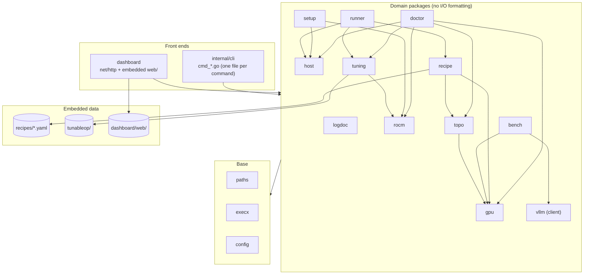

# rdnactl architecture

This document describes how the code is organized. The behavior contract is
[spec.md](spec.md). If the two disagree, spec.md is correct and this file is
a bug.

## 1. Layers



Rules:

1. Front ends parse input and format output. They hold no domain logic.
2. Domain packages return plain structs with JSON tags. They never print.
   They take a `context.Context` for anything that can block.
3. Domain packages read the host through an injectable root (`fs.FS` or a
   root path), so tests run on fixture trees under `testdata/`.
4. Arrows are the only allowed imports. `gpu` never imports `recipe`.
   `dashboard` and `cli` never import each other.
5. The JSON field names of domain structs are the public API (spec.md). Rename
   a field only together with spec.md.

## 2. Repository layout

```
rdnactl/
├── cmd/rdnactl/        main.go only: calls cli.Main
├── internal/
│   ├── cli/            router, --json/exit-code contract, cmd_<feature>.go
│   ├── paths/          XDG config/state/data/cache resolution
│   ├── execx/          bounded exec of external tools
│   ├── config/         <config>/config.yaml load/save
│   ├── host/           OS, distro, package manager, CPU, RAM, groups, devices, container engines
│   ├── gpu/            GPU enumeration (KFD + DRM + PCI sysfs), telemetry samples
│   ├── rocm/           ROCm installs, tools, libraries, venv probe
│   ├── topo/           PCIe tree, link classes, P2P matrix, bandwidth tests
│   ├── doctor/         check registry built from the packages above
│   ├── logdoc/         known-failure catalog (embedded YAML) and streaming log scanner
│   ├── flow/           status snapshot and `up` (composes doctor, setup, recipe, runner)
│   ├── setup/          install plan and non-root apply
│   ├── recipe/         schema, loading, extends/merge, validation, fit, plan rendering
│   ├── tuning/         TunableOp profiles and rows, GPU power cap
│   ├── runner/         host and container backends, run records, logs
│   ├── vllm/           client: /health, /v1/models, /tokenize, /metrics
│   └── bench/          streaming benchmark, result store
├── dashboard/          HTTP API + SSE; web/ assets embedded (no build step)
├── recipes/            built-in recipes (*.yaml, _*.yaml fragments) + embed.go
├── tunableop/          profiles.json + rows per rocBLAS build + embed.go
├── tuned-moe/          fork tuned MoE config + embed.go
├── deploy/
│   ├── packaging/      nfpm.yaml (rpm, deb)
│   ├── docker/         Dockerfile of the dashboard/CLI image
│   └── compose/        compose.yml (+ podman override), vLLM reference compose
├── scripts/            install.sh (release download + checksum), capture-fixture.sh
└── docs/               spec.md, architecture.md, recipes.md, install.md, third-party.md, overview.html
```

## 3. Package contracts

Signatures below are the agreed API between packages. Unexported helpers are
free.

### host

```go
type Info struct {
    Hostname, Kernel, PkgManager, Virtualization string
    OS   OSRelease   // ID, VersionID, Pretty
    CPU  CPU         // Model, Vendor, Sockets, Cores, Threads
    RAMBytes uint64
    User User        // Name, UID, Groups []string
    Engines []Engine // Name docker|podman, Path, Version, Rootless, Usable, Compose string
    SELinux string   // enforcing|permissive|disabled|""
    Cmdline string
}
func Probe(ctx context.Context, root string) (Info, error)   // root "/" in production
```

### gpu

```go
type GPU struct { HIPIndex, KFDNode int; Name, GFX string; GFXTargetVersion int;
    PCI, DeviceID string; VRAMBytes uint64; RenderMinor, NUMANode int;
    Link Link; PowerCapW float64; SysfsPath string }
type Sample struct { HIPIndex int; BusyPct, TempC, PowerW, PowerCapW float64;
    VRAMUsed, VRAMTotal uint64 }
func List(root string) ([]GPU, error)
func Telemetry(root string, gpus []GPU) []Sample
func GFXName(targetVersion int) string
```

### rocm

```go
type Install struct { Root, Version, Kind string }   // Kind: opt|therock|distro|wheel
type Report struct { Installs []Install; Tools map[string]string;   // name -> path
    ROCBLAS string; HIPVersion string; Agents []string }            // rocminfo gfx names
type VenvReport struct { Python, Torch, HIP, VLLM string; DeviceCount, RDNAOps int; Err string }
func Probe(ctx context.Context, root string) Report
func ProbeVenv(ctx context.Context, venv string) VenvReport
func VenvLibPaths(venv string) []string         // ROCm wheel libs + torch/lib, in load order
func FindROCBLAS(root, venv string) string       // venv wheel first, then system
```

### topo

```go
type Pair struct { A, B int; Class string; P2P bool; GBps float64 }
type Node struct { HIPIndex int; PCI string; Path []string; Switch string; RootPort string }
type Topology struct { Nodes []Node; Pairs []Pair; Bandwidth string } // Bandwidth: source used
func Discover(root string, gpus []gpu.GPU) (Topology, error)
func MeasureBandwidth(ctx context.Context, t *Topology, venv string) error
func BestGroup(t Topology, candidates []int, n int) (sel []int, reason string)
```

### doctor

```go
type Status string // ok|warn|fail|skip
type Check struct { ID, Category string; Status Status; Title, Detail, Fix, Doc string }
type Report struct { Summary map[Status]int; Checks []Check }
type Options struct { Root, Venv string; Categories []string }
func Run(ctx context.Context, o Options) Report
```

### logdoc

```go
type Rule struct { ID, Pattern, Cause, Fix, Doc, Severity string }
type Match struct { Rule; Line string; LineNo int }
func Load() ([]Rule, error)                       // embedded catalog.yaml, validated
func Scan(r io.Reader, rules []Rule) []Match      // first matching line per rule, streaming
func ScanFile(path string) ([]Match, error)
```

### setup

```go
type Step struct { ID, Title, Mode string; Root, Done bool; Commands []string; Why string }
type Options struct { Mode, Venv, Image, ModelRepo string }
func Plan(ctx context.Context, h host.Info, r rocm.Report, o Options) []Step
func Apply(ctx context.Context, steps []Step, only []string, log io.Writer) error
```

### recipe

```go
type Recipe struct { /* schema of spec.md §7.2 */ ID, Source string; Fragment bool; ... }
type LoadError struct { Source string; Err string }
type Set struct { Recipes map[string]*Recipe; Errors []LoadError }
func Load(extraDirs ...string) Set                 // embedded < config < $RDNACTL_RECIPES < extra
func (s Set) Resolve(id string) (*Recipe, error)   // extends merged
func Validate(r *Recipe) []string
type Fit struct { Status string; Reasons []string }  // fits|no|unknown
func CheckFit(r *Recipe, gpus []gpu.GPU, ramBytes uint64) Fit
type Plan struct {
    Recipe, Name, Mode, Model, ServedName, Host string
    Port int
    Env  map[string]string
    Args []string          // after "serve": model + flags
    HIPDevices string; GPUSelectReason string
    Image, ShmSize, TunableOpProfile string
    PathInputs []string
    Warnings []string
}
type PlanOptions struct { Mode, Name string; Sets []string; GPUs []gpu.GPU; Topo *topo.Topology }
func BuildPlan(r *Recipe, o PlanOptions) (*Plan, error)
```

### tuning

```go
type Profile struct { Name, Dir, ROCBLAS, ROCm, Torch, LibSHA256, Status string; RowsPerRank int; Covers []string }
func Profiles() ([]Profile, error)
func HashLib(path string) (string, error)
func Select(libSHA string, explicit string) (*Profile, error)
func Materialize(p *Profile) (dir string, err error)    // <data>/tunableop/<name>
func Env(p *Profile, rowsDir string, tuning bool) map[string]string
type Power struct { HIPIndex int; CapW, MinW, MaxW float64; Path string }
func PowerStatus(gpus []gpu.GPU) []Power
func SetPower(gpus []gpu.GPU, idx []int, watts float64) (cmds []string, err error) // cmds when not root
```

### runner

```go
type Record struct { Name, Recipe, Mode string; PID int; Container, Engine, Host string;
    Port int; StartedAt time.Time; Log string; Plan *recipe.Plan }
type Status struct { Record; State string }   // running|starting|exited
func Start(ctx context.Context, p *recipe.Plan, o StartOptions) (*Record, error)
func List(ctx context.Context) ([]Status, error)
func Stop(ctx context.Context, name string) error
func Logs(ctx context.Context, name string, follow bool, tail int, w io.Writer) error
func HostCommand(p *recipe.Plan, venv string) (argv []string, env []string, err error)
func ContainerCommand(p *recipe.Plan, eng host.Engine, rowsDir, hfCache string) []string
func Compose(p *recipe.Plan, rowsDir, hfCache string) ([]byte, error)
```

### vllm and bench

```go
// vllm
func New(baseURL string) *Client
func (c *Client) Health(ctx) error
func (c *Client) Models(ctx) ([]string, error)
func (c *Client) Tokenize(ctx, model, text string) (int, error)
func (c *Client) Metrics(ctx) (map[string]float64, error)   // flattened Prometheus samples
// bench
type Options struct { URL, Model, Tag string; InputLen, OutputLen, Warmup int;
    Concurrency []int; NumPrompts int; Seed int64 }
type Cell struct { Concurrency, Completed, Failed int; TTFTP50, TTFTP95, ITLP50, ITLP95,
    DecodeTokS, PrefillTokS, OutputTokS, DurationS float64 }
type Result struct { ID, Tag, URL, Model string; Time time.Time; Options Options;
    Fingerprint map[string]string; Cells []Cell }
func Run(ctx context.Context, o Options, progress io.Writer) (*Result, error)
func Save(r *Result) (string, error); func List() ([]Result, error); func Get(id string) (*Result, error)
```

## 4. Launch flow

```mermaid
sequenceDiagram
  actor Op as Operator / agent
  participant CLI as rdnactl serve
  participant R as recipe
  participant G as gpu + topo
  participant T as tuning
  participant X as runner
  Op->>CLI: serve flashnext-mtp2 --set PLE_QUANT_DIR=/data/ples
  CLI->>R: Load, Resolve (extends merge)
  CLI->>G: List GPUs, Discover topology
  CLI->>R: BuildPlan(sets, gpus, topo)
  R-->>CLI: Plan (env, args, HIP devices, warnings)
  CLI->>T: Select profile (host: hash rocBLAS; container: recipe profile)
  T-->>CLI: rows dir + TunableOp env
  CLI->>X: Start(plan) host process or container
  X-->>CLI: Record (pid/container, log, port)
  CLI-->>Op: run record (text or --json)
```

## 5. Testing

- Unit tests use fixture trees: `internal/<pkg>/testdata/<case>/sys/...`.
  Capture fixtures from real hosts with `scripts/capture-fixture.sh`.
- `recipe` tests check merge rules, interpolation, rendering and GPU
  selection. Every built-in recipe must validate (`go test ./recipes/...`).
- `runner` tests check the rendered argv and compose output, not process
  execution.
- `bench` tests use an in-process fake OpenAI server.
- Smoke on real hardware before a release: `doctor`, `topo`, `recipe plan`
  for each built-in recipe, one `serve` + `bench` cell.
