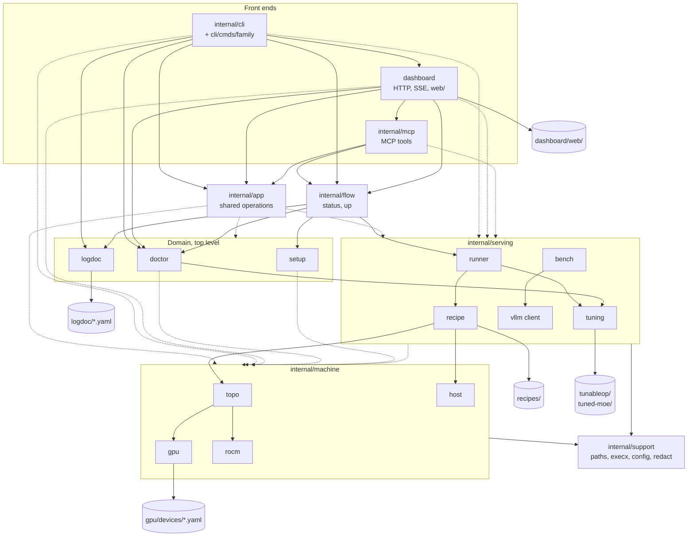
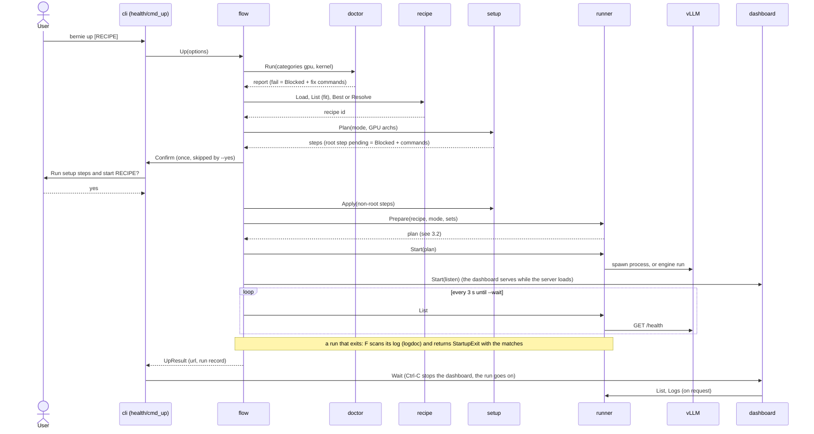
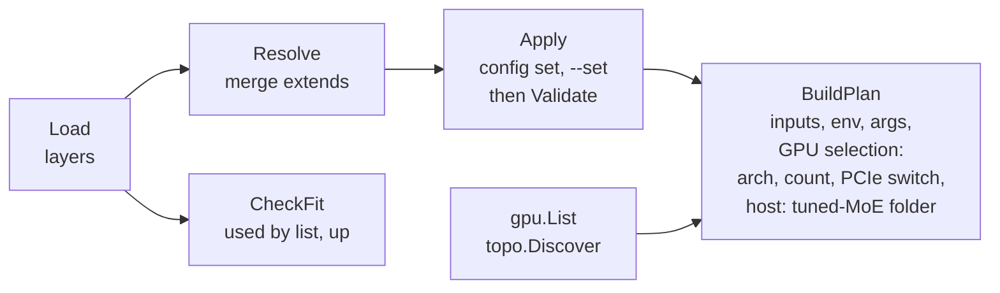
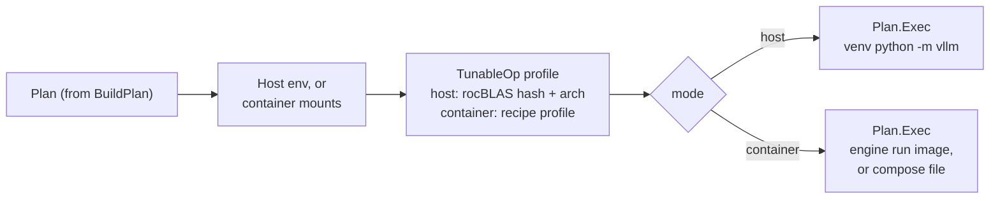
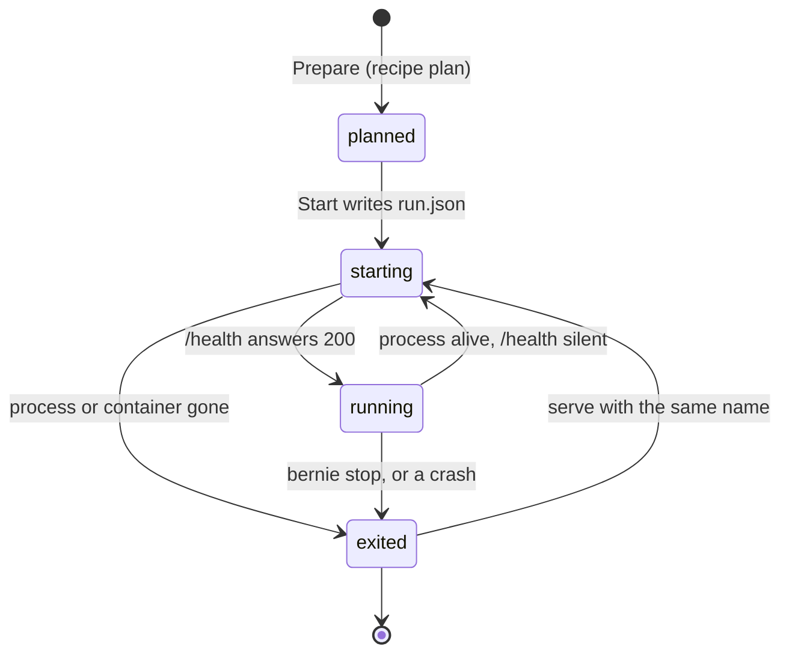
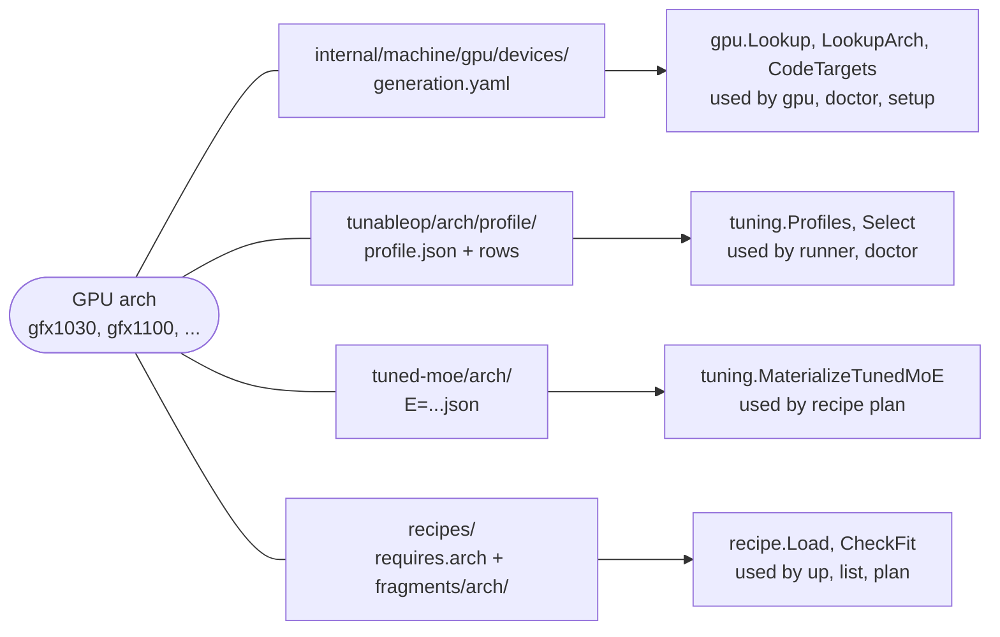

# bernie architecture

This document shows how the code is organized and how data moves through it.
The behavior contract is [spec.md](spec.md). If the two disagree, spec.md is
correct and this file is a bug.

Related pages:

- [packages.md](packages.md): the API of each package.
- [extending.md](extending.md): where to change what, and how to add a GPU
  generation.
- [recipes.md](recipes.md): how to write a recipe.

## 1. Layers

Packages sit in layers. An arrow means "imports". Nothing imports upward.
A solid arrow is a main dependency. A dotted arrow means "also imports
several packages of that group directly".



Two facts matter:

- `gpu` imports no other bernie package. It is the root of the graph.
- `dashboard` never imports `cli`. `cli` imports `dashboard` in three places:
  `dash`, `up` and `serve --dash`.
- `mcp` never imports `cli` or `dashboard`. `dashboard` imports `mcp` to
  mount `/mcp`; `cli` imports `mcp` for `bernie mcp`.

Rules:

1. Front ends (CLI, dashboard, MCP) parse input and format output. They hold
   no domain logic.
2. Domain packages return plain structs with JSON tags. They never print.
   They take a `context.Context` for anything that can block.
3. Domain packages read the host through an injectable root (a root path or
   an `fs.FS`), so tests run on fixture trees.
4. Arrows are the only allowed imports. `gpu` never imports `recipe`.
   `dashboard` never imports `cli`. `doctor` never imports `recipe`: the
   caller passes the validated architectures in `doctor.Options`.
5. The JSON field names of domain structs are the public API (spec.md).
   Rename a field only together with spec.md.
6. `flow` holds the two product-level chains (`status` and `up`).
   `runner.Prepare` is the only place that turns a recipe id into a ready
   plan. The CLI and the dashboard both call it.
7. `app` holds the operations that more than one front end runs and that no
   domain package owns: `hw`, `topo`, `doctor`, the run-log scan, `recipe
   list`, `tune` status and power, `setup` plan and apply, `bench` (run and
   save). Each returns the struct of its `--json` document. `app` never
   prints and never imports a front end.

## 2. Repository layout

```text
bernie/
├── cmd/bernie/           main.go: blank-imports each cmds family, calls cli.Main
├── internal/
│   ├── cli/              command framework, --json and exit-code contract, version
│   │   └── cmds/         one family package per area, one cmd_<name>.go per command
│   │       ├── health/       doctor, setup, status, up
│   │       ├── inventory/    hw, topo
│   │       ├── serving/      recipe, serve, ps, stop, logs, compose, config
│   │       ├── tunecmd/      tune
│   │       ├── benchcmd/     bench
│   │       ├── dashcmd/      dash
│   │       └── mcpcmd/       mcp
│   ├── app/              operations shared by the front ends, one `--json` document each
│   ├── mcp/              MCP server: tools, confirm tokens, audit (official Go SDK)
│   ├── flow/             status snapshot and `up`
│   ├── doctor/           check registry (one checks_<category>.go per category)
│   ├── setup/            install plan and non-root apply
│   ├── logdoc/           known-failure catalog, phase catalogue (embedded YAML) and log scanner
│   ├── machine/          what the host is
│   │   ├── gpu/              KFD/DRM/PCI enumeration, telemetry, devices/*.yaml tables
│   │   ├── host/             OS, package manager, CPU, RAM, groups, container engines
│   │   ├── rocm/             ROCm installs, tools, libraries, venv probe
│   │   └── topo/             PCIe tree, link classes, P2P matrix, bandwidth
│   ├── serving/          what bernie runs
│   │   ├── recipe/           schema, load, extends/merge, validate, fit, plan
│   │   ├── runner/           host and container backends, run records, logs
│   │   ├── tuning/           TunableOp profiles and rows, tuned-MoE folders, power cap
│   │   ├── vllm/             client: /health, /v1/models, /tokenize, /metrics
│   │   └── bench/            streaming benchmark and result store
│   └── support/          small shared helpers
│       ├── paths/            XDG config, state, data, cache
│       ├── execx/            bounded exec of external tools
│       ├── config/           <config>/config.yaml
│       ├── redact/           secret redaction for documents and log text
│       └── fixture/          test host snapshots (testdata/*.tar.gz)
├── dashboard/            HTTP API, SSE, embedded web/ (no build step)
├── recipes/              built-in recipes by family, fragments by concern, embed.go
├── tunableop/            <arch>/<profile>/ rows and profile.json, embed.go
├── tuned-moe/            <arch>/ fused-MoE configs, embed.go
├── deploy/               packaging (nfpm), docker, compose
├── scripts/              install.sh, capture-fixture.sh
└── docs/                 spec, architecture, packages, extending, recipes, install, overview.html
```

## 3. Flows

### 3.1 What `up` does

`up` is a thin front end over `flow.Up`. The sequence below shows who calls
whom. A step that cannot go on returns `Blocked`. `cli` prints it and exits
with code 3.



### 3.2 From recipe to command

`runner.Prepare` runs this chain. `recipe plan`, `serve`, `compose` and the
dashboard use the same chain. First, the recipe becomes a plan:



Then the plan gets the host and becomes a command:



### 3.3 Life of a run

The state of a run is not stored. `runner.List` derives it from the process
(or container) and `/health`. Only `run.json` is stored, when `Start`
succeeds. A plan has no record until it starts.



`exited` covers a normal `stop` and a failure. To tell them apart, run
`bernie doctor --run NAME`. It matches the log against the known-failure
catalog.

## 4. Data keyed by GPU architecture

Four kinds of data depend on the GPU. Each has one folder per key. A new
architecture adds files. It never edits the files of another architecture.



Rules:

- Every reader finds the data by walking the embedded tree. No Go file lists
  a device, a profile or a recipe.
- A profile says which architectures it fits in its own `profile.json`.
- `doctor` learns the validated architectures from the recipes
  (`recipe.ValidatedArchs`), not from a list.

[extending.md](extending.md) lists the steps to add a generation.

## 5. Testing

- Unit tests read a root path. Fixture trees live in
  `internal/support/fixture/testdata/<name>.tar.gz`. `fixture.Root(t, name)`
  unpacks one. Capture a real host with `scripts/capture-fixture.sh`.
- A fixture that was not captured is synthetic. Its name ends in
  `-synthetic` and it has a `SYNTHETIC` file at its root. The README next to
  the fixtures says which values are real and which are written by hand.
  Never present a synthetic fixture as proof of hardware support.
- `gpu` tests check that every device table loads, ids are unique and each
  override points to an arch of the same file.
- `tuning` tests check the layout of `tunableop/` and `tuned-moe/` (top
  folders are gfx names, at most 12 entries per folder) and that every
  `profile.json` name equals its folder name.
- `recipe` tests check merge rules, interpolation, rendering and GPU
  selection. Every built-in recipe must load, resolve, validate and plan
  (`go test ./recipes/...`).
- `runner` tests check the rendered argv and compose output. They do not run
  processes.
- `bench` tests use an in-process fake OpenAI server.
- Before a release, smoke on real hardware: `doctor`, `topo`, `recipe plan`
  for each built-in recipe, one `serve` and one `bench` cell.
