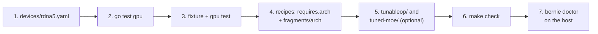

# Where to change what

This page tells you which files to touch for a common change, and which test
to run. Read [architecture.md](architecture.md) first for the layers. Run
`make check` before every commit.

## 1. Where do I change X

| I want to add | Change these files | Run this test |
|---|---|---|
| A command | `internal/cli/cmds/<family>/cmd_<name>.go` with `cli.Register` in `init()`. A new family folder needs one blank import in `cmd/bernie/main.go`. Put the logic in a domain package. Add the row to the table in [spec §3](spec.md#3-command-surface). | `go test ./internal/cli/... ./internal/<package>/...` |
| A doctor check | A function in `internal/doctor/checks_<category>.go` that returns `[]Check`. For a new category, add the function to the list in `evaluate` (`checks.go`) and the name to `Categories` (`doctor.go`). Add the row to [spec §5.2](spec.md#52-required-checks). | `go test ./internal/doctor/` (add a case to `TestEvaluateStatuses`) |
| A known-failure rule | A rule in `internal/logdoc/catalog.yaml`. The id is `<family>.<slug>`. | `go test ./internal/logdoc/` |
| A setup step | A `planner` method in `internal/setup/steps_<topic>.go`. Add it to the list in `Plan` (`setup.go`). Add the row to [spec §6](spec.md#6-setup). | `go test ./internal/setup/` |
| A recipe | `recipes/<family>/<id>.yaml`. The file stem is the id and is unique in the tree. See [recipes.md](recipes.md). | `go test ./recipes/...` |
| A recipe fragment | `recipes/_fragments/<concern>/_<id>.yaml`. Settings of one architecture go in `recipes/_fragments/arch/`. | `go test ./recipes/...` |
| A TunableOp profile | `tunableop/<arch>/<profile>/` with `profile.json`, `tunableop_results<rank>.csv`, `provenance.json`, `README.md`. The `name` in `profile.json` equals the folder name. Fields: `tunableop/README.md`. | `go test ./internal/serving/tuning/` |
| Tuned MoE configs | `tuned-moe/<arch>/E=...json`. Steps: `tuned-moe/README.md`. | `go test ./internal/serving/tuning/` |
| A device (a PCI id) | A row in `internal/machine/gpu/devices/<generation>.yaml`. The arch must exist in that file. | `go test ./internal/machine/gpu/` |
| A GPU generation | See [section 2](#2-how-to-add-a-new-gpu-generation). | See section 2. |
| A dashboard endpoint | A route in `dashboard/dashboard.go`, a handler in `dashboard/api.go` (or a new file), the UI call in `dashboard/web/app.js`. The handler calls the package behind the matching command. Add the row to [spec §11](spec.md#11-dashboard). Read `dashboard/AGENTS.md` first. | `go test ./dashboard/` |
| A JSON field | The struct tag in the domain package. Update the spec in the same commit. | The tests of that package. |
| A host fixture | `scripts/capture-fixture.sh <name>` on the real host. Copy the archive to `internal/support/fixture/testdata/`. A hand-made one is named `<name>-synthetic` and has a `SYNTHETIC` file. Add a row to `internal/support/fixture/testdata/README.md`. | `go test ./internal/machine/...` |

## 2. How to add a new GPU generation

Example: a new generation `rdna5` with the target `gfx1300`. The change is
data only. No Go file names a device.

1. **Write the device table.** Copy the closest file in
   `internal/machine/gpu/devices/` to `rdna5.yaml`. Set `generation: rdna5`
   (the file stem must match), `wave_size`, one entry per gfx target under
   `arches`, and one row per PCI id under `devices`. Write the sources in the
   header comment. Leave a field out when you have no source for it. Fields:
   [spec §4.4](spec.md#44-device-tables).
2. **Check the table.** Run `go test ./internal/machine/gpu/`. The test
   rejects duplicate ids, a device that names an unknown arch, and an
   `hsa_override` that points outside the file.
3. **Add a fixture.** Capture a real host with `scripts/capture-fixture.sh`.
   Without hardware, make a synthetic one (see the fixture README).
   Add a test in `internal/machine/gpu/gpu_test.go` that lists the fixture and
   checks the name and the gfx target.
4. **Add the recipe settings.** Make `requires.arch` of a recipe list `gfx13`
   (a prefix is enough). Put settings that hold only on this generation in
   `recipes/_fragments/arch/_rdna5.yaml`. Use `status: experimental` until a
   benchmark on real hardware proves the recipe. Then use `validated`.
5. **Add tuning data** when you have it:
   - `tunableop/gfx1300/<profile>/` with `profile.json` (`arch: ["gfx1300"]`);
   - `tuned-moe/gfx1300/` with the `E=...json` files.
6. **Run the tests.** Run `go test ./recipes/... ./internal/serving/tuning/ ./internal/doctor/`
   and then `make check`.
7. **Check on the host.** Run `bernie doctor`. The check
   `gpu.supported.gfx1300` is `ok` when a validated recipe lists the arch. It
   is `warn` when the arch is known but no validated recipe lists it. Run
   `bernie recipe list` and `bernie recipe plan <id>`.
8. **Update the docs.** Add the generation to the README status line if the
   hardware is validated. Change [spec.md](spec.md) only when a behavior
   changes.

What does not change: `gpu.List`, `doctor`, `setup`, `tuning` and `recipe`.
They read the new files by walking the embedded folders.

